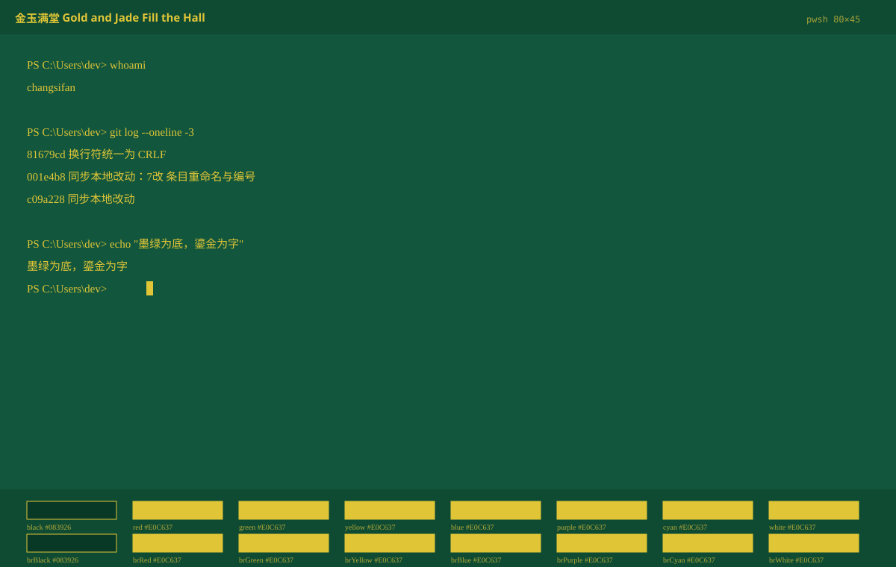

# 金镶玉 · Gold Inlaid Jade

墨绿为底，鎏金为字 —— 一套中国风的 **Windows Terminal** 配色。

A Chinese-style terminal color scheme for **Windows Terminal**: jade-green background, gold leaf text.



## 配色 / Palette

| 角色 / Role | 色值 / Hex |
|---|---|
| 背景 Background | `#12563D` |
| 前景 Foreground | `#E0C637` |
| 光标 Cursor | `#E0C637` |
| 选中 Selection | `#206F52` |
| 黑 Black / BrightBlack | `#083926` |
| 其余 6 色 + 8 亮色 | `#E0C637` |

配色思路很简单：**只留两种颜色**。底子是和田青玉的深绿，字是鎏金的黄。红绿黄蓝紫青白全都统一成金色，输出什么都是同一片金线，界面因此异常干净。

The idea is two colors only: jade green under, gold leaf on. All ANSI colors collapse into one gold, so any output still looks like gold thread on jade.

## 文件 / Files

| 文件 | 用途 |
|---|---|
| `gold-inlaid-jade.scheme.json` | 配色方案，放进 `schemes` 数组 |
| `jade-frame.theme.json` | 窗口与标签栏主题，放进 `themes` 数组 |

## 安装 / Install

1. 打开 Windows Terminal，按 `Ctrl + ,` 进入设置，点左下角 **打开 JSON 文件**。
2. 把 `gold-inlaid-jade.scheme.json` 的内容粘到顶层 `"schemes": [ ... ]` 里；把 `jade-frame.theme.json` 的内容粘到 `"themes": [ ... ]` 里。
3. 在 `profiles.defaults` 里指定：

```json
"profiles": {
  "defaults": {
    "colorScheme": "Gold Inlaid Jade",
    "font": { "size": 10, "cellHeight": "1.5" }
  }
}
```

4. 顶层加上 `"theme": "Jade Frame"`，保存即生效。

> 主题（`theme`、`themes`）需要 Windows Terminal 1.22 及以上。旧版本只用配色方案也完全够看。

## 姊妹项目 / Sister project

同样出自这个终端：[黑客帝国 / Make your terminal as cool as The Matrix](https://github.com/changsifan/Make-your-terminal-as-cool-as-The-Matrix)

## 许可 / License

MIT —— 见 [LICENSE](./LICENSE)。
